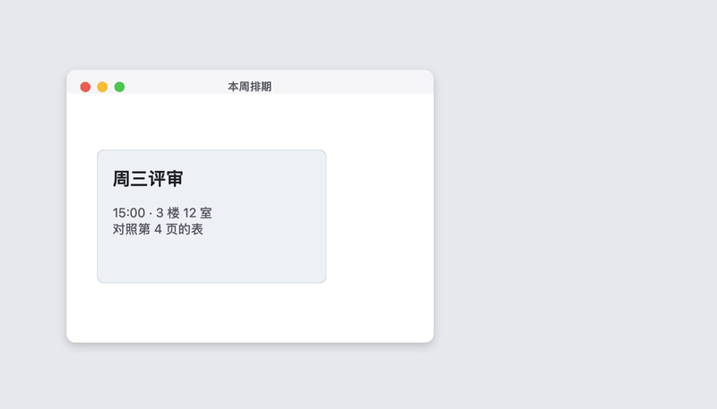
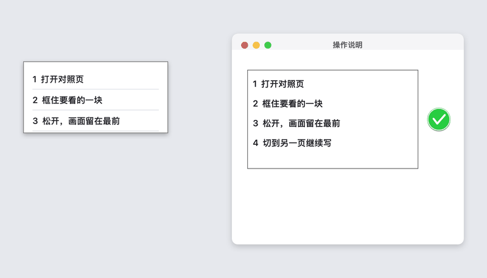

# PinTool (钉图)

[English](README.md) | 日本語 | [简体中文](README.zh-CN.md)

画面の一部を切り取って、すべてのウィンドウの最前面にピン留めするツールです。別のページやウィンドウと並べて見比べるときに、ウィンドウを何度も切り替える手間を省けます。

PinTool（钉图）がやることはこれだけです：ショートカットでの範囲選択、スクロールによる縦長キャプチャ、ドラッグでの移動。注釈の書き込み、履歴の保存、クラウドへのアップロード、画像編集機能はありません。

バージョン **0.1.2**。Apple Silicon 向けの DMG をダウンロードして使うか、ソースコードから自分でビルドできます。配布用 DMG もローカルビルドもアドホック署名（ad-hoc signing）のみで、Apple Developer ID 署名や公証（Notarization）、アプリ内自動アップデートはありません。（※現在のアプリ内 UI 表記は簡体字中国語「**钉图**」で、macOS の「プライバシーとセキュリティ」設定リストには「**PinTool**」という名前で表示されます。）

## 外観と動き

メニューバーの右側に画鋲（ピン）のアイコンが表示されます。Finder や「アプリケーション」フォルダでのアプリアイコンは、淡い紙の上に同じ画鋲を置いた、macOS の角丸矩形です。


⌃⌥A を押して範囲をドラッグし、マウスを離すと、その画面が最前面に残ります。後ろで別のウィンドウに切り替えても消えません。



縦長キャプチャでは、選択枠がその場に残ったまま、スクロールに合わせて左側のプレビューが細長く伸びていきます。スクロールし終えたら緑のチェックマークをクリックします。



アニメーション内のページはサンプルです。メニューバーの画鋲は実際のアイコンです。

## できること

- **選択範囲をピン留め（`钉住选区`）**：画面上の範囲をドラッグして離すと、その領域が元の位置に残り、他の通常ウィンドウより手前に固定されます。
- **縦長キャプチャ（`长截图钉住`）**：最初に囲んだ枠がその場に固定されます。マウスを離したあと、枠の中で自分のペースで下にスクロールし、好きな位置で止められます。スクロールが止まるのを待たずに連続して撮影・結合され、左側のプレビューが縮小されながら縦に伸びていきます。緑のチェックマークをクリックするとピン留めが完了します。
- **移動（ドラッグ）**：ピン留めした画像をつかんで自由に移動できます。macOS の操作スペース（デスクトップ）をまたいで追従し、通常のウィンドウに隠れません。
- **拡大・パン**：ピン留めした画像の上でスクロールまたはピンチすると、カーソル位置を中心に拡大されます（ウィンドウは画面内に収まるよう調整されます）。拡大中にドラッグすると画像の表示位置を移動（パン）でき、**Option** キーを押しながらドラッグするとウィンドウ全体を移動できます。
- **閉じる**：マウスを乗せて右上の `×` をクリックするか、右クリックメニューから閉じます（`关闭这个钉图`）。メニューバーからすべてのピンを一括で閉じることもできます（`关闭全部钉图`）。
- **コピー**：ピン留め画像の上で右クリックして「画像をクリップボードにコピー」（`拷贝图像到剪贴板`）を選ぶか、⌘C を押します。ファイルには書き出さず、画像全体がクリップボードにコピーされます。拡大表示中でも、見えている一部分だけでなく画像全体がコピーされます。

複数のピンを同時に並べておくことができます。画像はメモリ上にのみ保持され、アプリを終了すると消えます。クリップボードにコピーした画像は、別の内容をコピーするまで他のアプリに貼り付けられます。

デフォルトのショートカット：

| 操作 | ショートカット |
| --- | --- |
| 選択範囲をピン留め（`钉住选区`） | ⌃⌥A |
| 縦長キャプチャしてピン留め（`长截图钉住`） | ⌃⌥S |

メニューバーの画鋲アイコンから別のキーの組み合わせに変更できます（`更改钉住选区快捷键…` / `更改长截图快捷键…`）。Control、Option、Command のいずれかを含める必要があります。

## ダウンロードとインストール

[Releases](https://github.com/jayson-sheyue/PinTool/releases/tag/v0.1.2) から `PinTool-0.1.2-arm64.dmg` をダウンロードします。Apple Silicon（`arm64`）かつ macOS 15 以降のみ対応しています。Intel Mac 用のパッケージはなく、Intel 環境での動作確認も行っていません。

1. DMG を開き、**钉图**（`PinTool.app`）を「アプリケーション」フォルダにドラッグします。
2. 初回起動時は公証がないためシステムにブロックされます。「システム設定 → プライバシーとセキュリティ」を開き、このアプリを開くことを許可してください（`このまま開く`）。システム整合性保護（SIP）や Gatekeeper 全体を無効化しないでください。
3. メニューバーの右側、他のステータスアイコンの並びに画鋲アイコンが表示されます。

新しくダウンロードしたパッケージに差し替えるたび、アドホック署名が変わります。「画面収録」の許可リストに古い **PinTool** が残っている場合は、一度選択してマイナス（`-`）ボタンで削除してから再度許可し、案内ウィンドウの「PinTool を開き直す」（`重新打开钉图`）をクリックしてください。

アプリ内自動アップデートはありません。新しいバージョンは Releases から手動でダウンロードしてください。ファイルの SHA-256 はダウンロードの破損確認にのみ使え、Apple の公証の代わりにはなりません。

## はじめて使うとき

1. **钉图**（`PinTool.app`）を開きます。メニューバーの右側に画鋲アイコンが現れます（ウィンドウ左上のナビゲーションを邪魔しないよう、左側には配置されません）。
2. 自動で開く案内ウィンドウを確認します。
3. 「設定を開く」（`打开设置`）をクリックし、**PinTool** の画面収録を許可します。macOS の設定リストには「钉图」ではなく **PinTool** という名前で表示されます。
4. 画面収録の権限はアプリを終了して開き直すまで反映されません。案内ウィンドウにある「PinTool を開き直す」（`重新打开钉图`）をクリックします。
5. 見たいウィンドウに戻り、⌃⌥A を押して範囲をドラッグし、離します。

縦長キャプチャは ⌃⌥S です。画面全体ではなく、スクロールするコンテンツ領域だけを囲んでください。マウスを離すと枠がその場に残るので、自分で下にスクロールします。スクロール中、その領域が連続して切り取られ、左側のプレビューが細長く伸びていきます。最後までスクロールしたら枠の横にある緑のチェックマークをクリックすると、ピン留め画像が残ります。画像の上でスクロールするとカーソル位置を中心に拡大できます。`Esc` キーまたはもう一度 ⌃⌥S を押しても完了できます。

## ソースからビルドする

ローカルでビルドしたアプリもアドホック署名（`codesign --force --sign -`）となり、公証済みのインストーラではなく、自動アップデートもありません。配布用の DMG は `./scripts/build-dmg.sh` で生成され、`dist/` に出力されます（リポジトリには含まれません）。

macOS 15 と Swift 6 Command Line Tools が必要です。Xcode 本体を別途インストールする必要はありません。

```bash
./scripts/check.sh
./scripts/build-app.sh
open PinTool.app
```

`scripts/check.sh` は画像結合、座標変換、画像読み書きの検査をコンパイルして実行します。Xcode 同梱の `XCTest` がない環境でも動くよう、検査は独立した実行バイナリ（`PinToolChecks`）になっており、失敗時は非 0 で終了します。`scripts/build-app.sh` は実行中マシンのアーキテクチャ向けに `PinTool.app` を生成し、アドホック署名を行います。

署名なし／未公証のため開けないと表示された場合：Finder で `PinTool.app` を右クリックして「開く」を選ぶか、「システム設定 → プライバシーとセキュリティ」で今回のみ開くことを許可してください。SIP や Gatekeeper 全体を無効化しないでください。

再ビルドするたびにアドホック署名が変わります。システム設定のスイッチがオンのままでも前回のバイナリに対する許可として扱われるため、案内ウィンドウでは「未許可」（`未允许`）と表示されます。その場合はリストで **PinTool** を選んでマイナス（`-`）で削除し、もう一度追加・許可してからアプリを開き直してください。オンになっているスイッチをただ切り替え直すだけでは反映されません。

日常利用で `swift run` を直接使わないでください。macOS の権限は `.app` バンドル単位で記憶されるため、生バイナリを直接実行すると権限が一致しません。

## 権限について

| 権限 | 必要な場面 | 許可しない場合の挙動 |
| --- | --- | --- |
| 画面収録（`屏幕录制`） | すべてのキャプチャ | 撮れたふりをせず案内を表示します。スイッチがオンでも「未許可」（`未允许`）になる場合は、古い `PinTool` を `-` で削除して再度許可し、開き直してください |
| アクセシビリティ（`辅助功能`） | 現在不要 | 縦長キャプチャはユーザー自身がスクロールするため、この権限は使いません |

設定案内はメニューバーの「使い方…」（`使用说明…`）からもいつでも開けます。

## 診断情報

メニューバー →「診断情報をコピー」（`拷贝诊断信息`）。アプリのバージョン、macOS バージョン、権限の状態、直近のステータスメッセージのみがクリップボードにコピーされ、画面の内容（画像データ）は一切含まれません。問題が起きた際はこのテキストを添えて報告してください。

## 既知の制限事項

- macOS 15 以降のみ対応。ビルドスクリプトは実行中マシンのアーキテクチャ向けにビルドします。開発機は Apple Silicon（`arm64`）であり、Intel Mac では未検証です。
- キャプチャした画像はメモリ上にのみ存在します。アプリの終了、クラッシュ、または Mac のシャットダウンで消えます。右クリックまたは ⌘C はクリップボードに画像をコピーするだけで、ファイルには保存しません。
- 縦長キャプチャはスクロールに合わせて連続撮影し、左側のプレビューを更新します。前後のフレーム間で選択枠の高さの約 15% 以上が重なり、かつ文字が同じ水平位置で一致したときに結合されます。リスト表示で行ごとの矢印や余白が似ていても、文字自体が一致したときだけ繋ぐため、1 行ずれて重なることを防ぎます。一致しない区間は無理に繋ぎません。緑のチェックマークまたは `Esc` / ⌃⌥S で終了します。一致しない区間をスクロールし過ぎた場合、欠けた内容を推測して補完することはしません。
- ページ内にアニメーションがある場合、確実に一致した部分で結合が止まります。
- ページ下部に固定された文字入りバー（スティッキーフッター）は可能な限り重複を除きますが、単色の下部バーは繰り返し残ることがあります。上部の固定バーは通常 1 回だけ現れます。
- 縦長画像の最大高は約 20,000 ピクセルです。上限に達するとそれ以上は伸びなくなりますが、選択枠と緑のチェックマークは残るため、そのままクリックしてピン留めできます。
- システムで保護された映像（DRM 保護された動画など）は macOS の制限によりキャプチャできません。
- ピン留めウィンドウ自体は他のスクリーンショットツールから見えます（`sharingType = .readOnly`）。一方、PinTool 自身の選択オーバーレイや進捗表示はキャプチャに写り込みません。
- 配布用パッケージもローカルビルドもアドホック署名であり、公証やアプリ内自動アップデートはありません。`0.1.2` の DMG には Apple Silicon マシンでビルドされた `arm64` バイナリのみが含まれ、アプリアイコンは macOS の角丸矩形です（`0.1.1` のキャプチャ動作は同じでアイコンは正方形、`0.1.0` にはクリップボードコピーがなく、縦長キャプチャで似た行が重なる問題がありました）。

## チェック手順

コードを変更したあとは以下のコマンドを実行します：

```bash
./scripts/check.sh
```

このコマンドは画像結合、座標変換、画像読み書きのチェックをコンパイルして実行します。実際の画面キャプチャは含まれないため、画面収録とスクロール動作は `PinTool.app` を起動して手動で確認する必要があります。

手動確認項目：

1. 画面収録の権限がない状態でショートカットを押したとき、空の画像が出るのではなく案内ウィンドウが表示されること。
2. ⌃⌥A で範囲選択したあと、元の位置にピンが表示され、ドラッグで移動でき、ウィンドウを切り替えても最前面に残ること。
3. スクロールまたはピンチで拡大縮小でき、マウスを乗せると閉じるボタンが出ること。右クリックまたは ⌘C で画像全体をコピーできること。
4. スクロール可能なページで ⌃⌥S でコンテンツ領域を囲み、下にスクロールすると左側のピン留めプレビューが縦に伸びること。
5. 枠の横の緑のチェックマークをクリックすると、ピン留め画像が残り、ドラッグで移動でき、アプリが終了しないこと（`Esc` でも終了できること）。

## システム API

画面キャプチャには macOS 標準の [ScreenCaptureKit](https://developer.apple.com/documentation/screencapturekit) を使用しています。最小対応システムは macOS 15 で、[`Package.swift`](Package.swift) の `platforms` 設定と一致しています。

## ライセンス

[MIT](LICENSE)。
