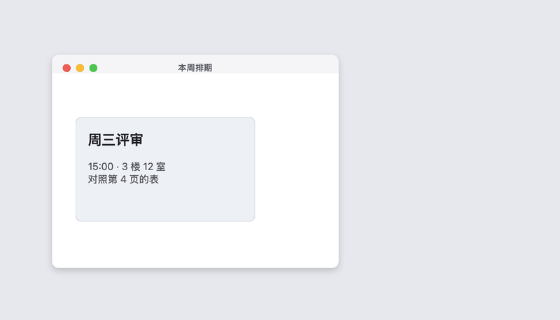
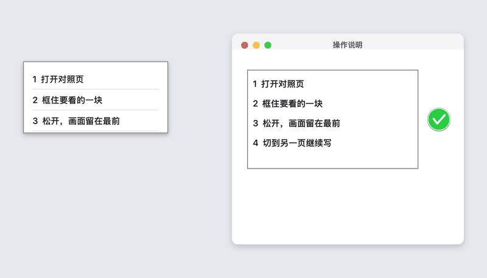

# PinTool (钉图)

English | [日本語](README.ja.md) | [简体中文](README.zh-CN.md)

Pin a region of your screen on top of all other windows so you can compare it side by side with another page or app without switching back and forth.

PinTool does only this: region capture via hotkey, scrolling long capture, and click-and-drag floating pins. There is no annotation, history, cloud upload, or image editing.

Version **0.1.2**. You can download the Apple Silicon DMG or build from source. Both the downloadable DMG and local builds use ad-hoc code signing only — there is no Apple Developer ID signature, no notarization, and no in-app auto-updater. (Note: the in-app interface labels are currently in Simplified Chinese, displayed as **钉图**, while the binary in macOS Privacy & Security settings is listed as **PinTool**.)

## At a Glance

A pushpin icon sits on the right side of the macOS menu bar. The application icon in Finder and Applications is that same pushpin on a light sheet of paper, shaped as the macOS rounded rectangle.


Press ⌃⌥A and drag to select a region. When you release, that capture stays floating on top — even when you switch to other windows behind it.



During a scrolling long capture, the selection frame stays in place while the preview on the left grows taller and narrower as you scroll. Click the green checkmark when finished.



The pages shown in the animations are examples; the pushpin in the menu bar is the actual icon.

## Features

- **Pin Region (`钉住选区`)**: Drag to select an area on screen. Once released, the captured region stays in place and floats above all normal windows.
- **Scrolling Long Capture (`长截图钉住`)**: The initial selection frame stays anchored on screen. After releasing the mouse, scroll down inside the frame at your own pace and stop whenever you want. Frames are stitched continuously as you scroll without waiting for scrolling to stop, while the live preview on the left scales down to fit. Click the green checkmark to pin the finished image.
- **Drag**: Click and drag any pin to move it around. Pins follow you across macOS Spaces and stay above normal windows.
- **Zoom & Pan**: Scroll or pinch on a pinned image to zoom centered on the cursor while keeping the window clamped within the screen. When zoomed in, dragging pans across the image; hold **Option** while dragging to move the entire pin window.
- **Close**: Hover over a pin and click the `×` button in the top-right corner, or right-click and choose Close (`关闭这个钉图`). You can also close all pins at once from the menu bar (`关闭全部钉图`).
- **Copy**: Right-click a pin and choose **Copy Image to Clipboard** (`拷贝图像到剪贴板`), or press ⌘C. The full-resolution image is copied to the system clipboard without writing any file to disk. Even when zoomed in, the entire image is copied rather than only the visible viewport.

You can pin multiple regions at the same time. Pinned images live only in memory and disappear when you quit the app. Any image copied to the clipboard remains available to paste into other apps until you overwrite the clipboard.

Default shortcuts:

| Action | Shortcut |
| --- | --- |
| Pin Region (`钉住选区`) | ⌃⌥A |
| Scrolling Long Capture (`长截图钉住`) | ⌃⌥S |

You can customize both shortcuts from the pushpin icon in the menu bar (`更改钉住选区快捷键…` / `更改长截图快捷键…`). Shortcuts must include at least one of Control, Option, or Command.

## Download & Install

Download `PinTool-0.1.2-arm64.dmg` from [Releases](https://github.com/jayson-sheyue/PinTool/releases/tag/v0.1.2). Supported only on Apple Silicon (`arm64`) running macOS 15 or later. There is no Intel Mac build, and Intel Macs have not been tested.

1. Open the DMG and drag **钉图** (`PinTool.app`) into **Applications**.
2. On first launch, macOS will block the app because it is not notarized. Go to **System Settings → Privacy & Security** and allow it to open once (`Open Anyway`). Do not disable System Integrity Protection (SIP) or turn off Gatekeeper globally.
3. A pushpin icon will appear on the right side of the menu bar alongside your other status icons.

Every newly downloaded or rebuilt bundle has a different ad-hoc signature. If an older **PinTool** entry already exists under Screen Recording permissions, select it and click the minus (`-`) button to remove it, grant permission again, and click **Reopen PinTool** (`重新打开钉图`) in the guide window.

There is no in-app auto-updater. To update to a future version, download the new DMG from Releases manually. Checking a file's SHA-256 only verifies download integrity and does not replace Apple notarization.

## First-Time Use

1. Open **钉图** (`PinTool.app`). A pushpin icon appears on the right side of the menu bar (it avoids parking on the far left so it never covers window navigation controls).
2. Read the guide window that opens automatically.
3. Click **Open Settings** (`打开设置`) and allow **PinTool** to use Screen Recording. Note that the entry in the macOS permission list is named **PinTool**, not `钉图`.
4. Screen Recording permission only takes effect after quitting and reopening the app. Click **Reopen PinTool** (`重新打开钉图`) in the guide window.
5. Return to the window you want to reference, press ⌃⌥A, drag out a region, and release.

For a scrolling long capture, press ⌃⌥S. Select only the scrollable content area — do not select the entire screen. After you release the mouse, the frame stays in place while you scroll down manually. As you scroll, PinTool continuously captures and stitches the region, and the preview on the left grows taller and narrower. When finished, click the green checkmark next to the frame to keep the pin. You can scroll on the pinned result to zoom around the cursor. Pressing `Esc` or ⌃⌥S again also finishes the capture.

## Build from Source

Local source builds also use ad-hoc signing (`codesign --force --sign -`), are not notarized, and do not include auto-update. The distributable DMG is built with `./scripts/build-dmg.sh`, which outputs to `dist/` (ignored by git).

Requires macOS 15 and Swift 6 Command Line Tools. A full Xcode installation is not required.

```bash
./scripts/check.sh
./scripts/build-app.sh
open PinTool.app
```

`scripts/check.sh` compiles and runs the stitching, coordinate conversion, and image read/write verification suite. Because Command Line Tools environments do not include Xcode's `XCTest`, the checks run as a standalone executable (`PinToolChecks`) that exits non-zero on failure. `scripts/build-app.sh` builds `PinTool.app` for the current machine architecture and applies an ad-hoc signature.

If macOS says the unsigned/unnotarized app cannot be opened: right-click `PinTool.app` in Finder and choose **Open**, or allow it once in **System Settings → Privacy & Security**. Do not disable SIP or Gatekeeper globally.

Every rebuild changes the ad-hoc signature. The toggle in System Settings may still appear switched on for the previous binary while the guide window reports **Not Allowed** (`未允许`). Select **PinTool** in the Screen Recording list, click the minus (`-`) button to remove it, add/enable it again, and reopen the app. Simply toggling the existing switch off and on is not enough.

Do not use `swift run` for normal usage — macOS tracks Screen Recording permissions per `.app` bundle, so running the raw binary directly will not match the bundle permission.

## Permissions

| Permission | When Required | Behavior Without Permission |
| --- | --- | --- |
| Screen Recording (`屏幕录制`) | All screen captures | Fails honestly without pretending to capture. If the toggle is on but still shows Not Allowed (`未允许`), remove the old `PinTool` entry with `-`, allow it again, and reopen the app |
| Accessibility (`辅助功能`) | Not required | Scrolling long captures are scrolled manually by you and do not use Accessibility permissions |

You can reopen the permission guide anytime from the menu bar via **Usage Guide…** (`使用说明…`).

## Diagnostics

Menu bar → **Copy Diagnostics** (`拷贝诊断信息`). This copies the app version, macOS version, permission states, and recent status messages to the clipboard — never any screen pixels. Paste this text when reporting an issue.

## Known Limitations

- Supports macOS 15 and later only. The build scripts compile for the host machine's architecture. This project was developed and verified on Apple Silicon (`arm64`); Intel Macs have not been verified.
- Captures stay in memory only. Quitting, crashing, or shutting down clears all pinned images. Right-clicking or pressing ⌘C copies the image to the clipboard without writing files to disk.
- Scrolling long capture stitches frames continuously as you scroll. Adjacent frames are stitched only when at least ~15% of the selection height overlaps and the text aligns at the same horizontal position. In lists where row arrows and whitespace look identical, stitching only commits when the text itself matches, preventing off-by-one row overlap. Unmatched segments are not forced together; if you scroll past an unmatchable section, missing content is not guessed. Capture ends when you click the green checkmark or press `Esc` / ⌃⌥S.
- If the page contains animations inside the capture region, stitching stops at the last reliable part.
- Sticky bottom bars containing text are deduplicated when possible, though solid-color bottom bars may still repeat. Sticky top headers generally appear only once.
- Maximum long-capture height is approximately 20,000 pixels. Once reached, the image stops growing while the frame and green checkmark remain available to finish and pin.
- DRM-protected content (such as protected video playback) cannot be captured due to macOS limitations.
- Pinned windows are visible to other screenshot tools (`sharingType = .readOnly`), whereas PinTool's own selection overlay and progress HUD are excluded from its captures.
- Both downloaded DMGs and local builds are ad-hoc signed, unnotarized, and have no auto-updater. The `0.1.2` DMG contains only the `arm64` binary built on Apple Silicon. Its app icon is the macOS rounded rectangle (`0.1.1` had the same capture behavior with a square icon; `0.1.0` lacked clipboard copy and could collapse similar list rows during long captures).

## Verification Checks

After modifying code, run the automated check suite:

```bash
./scripts/check.sh
```

This compiles and runs stitching, coordinate conversion, and image read/write checks. It does not perform live screen capture; Screen Recording and scrolling behavior must be verified manually after launching `PinTool.app`.

Manual verification checklist:

1. Without Screen Recording permission, pressing a capture shortcut shows the guide/explanation rather than producing a blank pin.
2. After selecting a region with ⌃⌥A, the pin appears at the original screen position, can be dragged, and remains on top when switching windows.
3. Scrolling or pinching zooms around the cursor; hovering reveals the close button; right-clicking or pressing ⌘C copies the full image to the clipboard.
4. On a scrollable page, selecting the content area with ⌃⌥S and scrolling down lengthens the live preview on the left.
5. Clicking the green checkmark next to the frame leaves the pinned long image on screen, movable, without quitting the app (`Esc` also finishes).

## System APIs

Screen capture uses macOS's built-in [ScreenCaptureKit](https://developer.apple.com/documentation/screencapturekit). The minimum deployment target is macOS 15, matching `platforms` in [`Package.swift`](Package.swift).

## License

[MIT](LICENSE).
