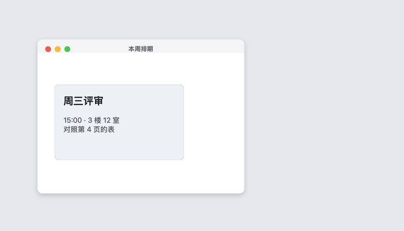
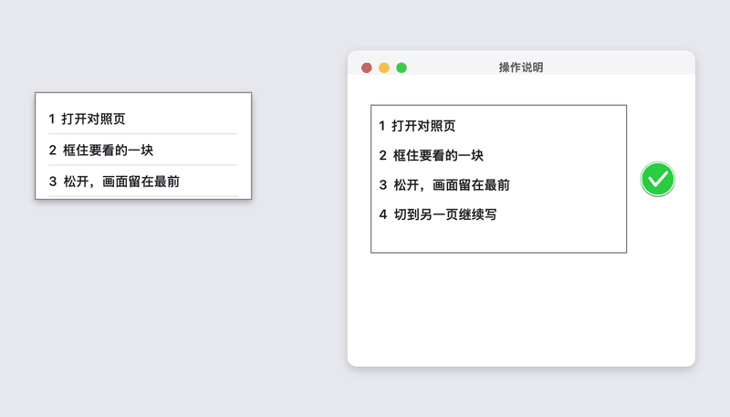

# 钉图

把屏幕上的一块内容钉在所有窗口最前面。用来对照另一个页面或窗口，不用来回切换。

钉图只做这件事：快捷键框选、长截图、按住拖动。没有标注、历史、上传或编辑。

版本 **0.1.1**。可以下载 Apple Silicon 的 DMG，也可以自己构建。下载包只有本机临时签名，没有 Apple 开发者签名，也没有公证，没有应用内更新。

## 看一眼

菜单栏右侧有一个图钉。


按 ⌃⌥A 拖出一块，松开后这块画面留在最前面。后面换成别的窗口，它还在。



长截图时框留在原地，左边的图跟着变长、变瘦。滚完点绿勾。



图里的页面是示例。菜单栏上的图钉是真实图标。

## 能做什么

- **钉住选区**：拖出一块区域，松开后，这块画面留在原位置，并且盖在其他窗口上面。
- **长截图**：第一次框住的区域留在原地。松开后由你在框里向下滚，速率和停在哪里都自己定。画面连续接着截，不用等滚停。左边的长图会变瘦、变长。点绿勾钉住。
- **拖动**：按住钉图就能移动。它可以跟着你跨桌面，普通窗口盖不住它。
- **放大**：在钉图上滚动或捏合，按光标所在的位置放大，窗口停在屏幕里。放大之后拖动是查看图的其它部分；按住 Option 再拖，移动整张图。
- **关闭**：鼠标移上去，点右上角的 ×；也可以右键关闭。菜单栏里可以一次关掉全部。
- **拷贝**：在钉图上右键选「拷贝图像到剪贴板」，或按 ⌘C。整张图进剪贴板，不写文件。放大后拷的仍是整张，不是只看见的那一块。

可以同时钉住多块。钉图不写入磁盘，退出后就没了。剪贴板里的那一份可以粘贴到别的应用，直到你再拷贝别的内容。

默认快捷键：

| 动作 | 快捷键 |
| --- | --- |
| 钉住选区 | ⌃⌥A |
| 长截图钉住 | ⌃⌥S |

菜单栏图钉图标里可以改成别的组合。需要带上 Control、Option 或 Command。

## 下载安装

从 [Releases](https://github.com/jayson-sheyue/PinTool/releases/tag/v0.1.1) 下载 `PinTool-0.1.1-arm64.dmg`。只适用于 Apple Silicon（arm64）和 macOS 15 及以上。Intel Mac 没有这个包，也没有在 Intel 上验证过。

1. 打开 DMG，把钉图拖进「应用程序」。
2. 第一次打开会被系统拦住，因为这个包没有公证。到「系统设置 → 隐私与安全性」，允许打开这一次。不要关闭系统完整性保护，也不要关闭整个 Gatekeeper。
3. 菜单栏右侧、和其他状态图标一起，会出现一个图钉。

每次换一个新下载的包，临时签名都会变。屏幕录制里如果还留着旧的 PinTool，先选中它点减号删掉，再允许一次，然后点说明窗口里的「重新打开钉图」。

没有应用内更新。以后的版本需要自己到 Releases 下载。文件的 SHA-256 只能核对有没有下错，不能代替 Apple 公证。

## 第一次使用

1. 打开钉图。菜单栏右侧会出现图钉，它不放在左边，免得挡住窗口左上角的导航。
2. 阅读打开的说明窗口。
3. 点「打开设置」，允许 **PinTool** 使用屏幕录制。列表里的名字是 PinTool，不是「钉图」。
4. 屏幕录制要等退出并重新打开才生效。说明窗口里有「重新打开钉图」。
5. 回到你要看的窗口，按 ⌃⌥A，拖出范围，松开。

长截图用 ⌃⌥S。框住会滚动的内容，不要把整块屏幕框进去。松开后框留在原地，由你向下滚。滚动时连续截这一块，左边的长图跟着变瘦、变长。滚完点框旁边的绿勾，钉图留下。在图上滚动可以按光标放大某一块。Esc 或再按一次 ⌃⌥S 也可以结束。

## 从源码构建

自己构建出来的也是本机临时签名，不是已公证的安装包，也没有自动更新。下载用的 DMG 由 `./scripts/build-dmg.sh` 生成，产物在 `dist/`，不会写进仓库。

需要 macOS 15 和 Swift 6 命令行工具。不需要单独安装 Xcode。

```bash
./scripts/check.sh
./scripts/build-app.sh
open PinTool.app
```

`scripts/check.sh` 编译并运行拼接、坐标和图像读写检查。这台环境没有 Xcode 自带的 XCTest，所以检查是一个独立的小程序，失败时会以非 0 退出。`scripts/build-app.sh` 生成当前机器架构的 `PinTool.app`，并做本机临时签名。

如果系统提示无法打开未签名的应用：在 Finder 里对 `PinTool.app` 点右键，选「打开」。或者到「系统设置 → 隐私与安全性」里只允许打开这一次。不要关闭系统完整性保护，也不要关闭整个 Gatekeeper。

每次重新构建后，临时签名会变。系统设置里的开关可能还开着，但记的是上一版，所以说明窗口仍会写「未允许」。这时在列表里选中 PinTool，点减号删掉，再打开一次开关，然后重新打开钉图。不要只重复拨弄已经开着的开关。

不要用 `swift run` 当成日常入口。权限是按 `.app` 记住的，直接跑二进制会对不上。

## 权限

| 权限 | 何时需要 | 没用时会怎样 |
| --- | --- | --- |
| 屏幕录制 | 任何截图 | 不会假装截到了。开关开着但仍是未允许时，删掉旧的 PinTool 再允许一次，然后重新打开 |
| 辅助功能 | 当前用不到 | 长截图由你自己滚动页面，不靠这项权限 |

设置入口也在菜单栏的「使用说明…」里。

## 诊断

菜单栏 →「拷贝诊断信息」。里面有版本、系统、权限状态和最近几条状态，没有画面内容。出问题时把这段文字留下即可。

## 已知限制

- 只支持 macOS 15 及以上。当前脚本打出来的是这台电脑的架构。这台开发机是 Apple Silicon（arm64），Intel Mac 没有验证过。
- 画面只在内存里。退出、崩溃或关机后钉图消失。右键或 ⌘C 只把图放进剪贴板，不写成文件。
- 长截图在你滚动时连续截取这一块，左边跟着变。两帧之间大约还留下选框高度一成五、并且文字对得上同一个位置时，才会接上。列表里每行的箭头和空白很像，只有文字本身对上才接，错开一行不会叠上去。对不上的一截不会硬接。点绿勾或按 Esc 才结束。滚过了对不上的那一截，缺掉的内容不会被猜进去。
- 页面里如果有动画，拼接会停在已经可靠的部分。
- 固定在页面底部、又带文字的横条会尽量只留一次。纯色底栏仍可能重复。固定在顶部的横条一般只出现一次。
- 长图最高大约 20000 像素。到了就不再变长，框和绿勾还在，点绿勾钉住。
- 受系统保护的画面（比如部分视频）截不到，这是 macOS 的限制。
- 钉图窗口本身可以被其他截图工具看到。选区遮罩和进度提示不会被钉图自己截进去。
- 下载包和本机构建都是临时签名，没有公证，没有应用内更新。0.1.1 的 DMG 只包含这台 Apple Silicon 机器打出来的 arm64 程序。0.1.0 的包还没有剪贴板拷贝，长截图也还会把相似的行叠在一起。

## 检查

日常改完代码后：

```bash
./scripts/check.sh
```

这条命令会编译并运行拼接、坐标换算和图像读写检查。它不包含真实截图：屏幕录制和滚动要在打开 `PinTool.app` 后手工确认。

手工要看的路径：

1. 没有屏幕录制权限时，快捷键会给出说明，不会出现一块空图。
2. ⌃⌥A 框选后，钉图出现在原位置，按住能拖，切换窗口后仍在最前。
3. 滚轮或捏合可以缩放，移上去能关闭。右键可以拷贝整张图，⌘C 也可以。
4. 在可滚动页面用 ⌃⌥S 框住内容区，向下滚动时左边的钉图变长。
5. 点框旁边的绿勾后，钉图留着，可以拖走，程序不退出。Esc 也能结束。

## 系统接口

截图使用系统自带的 [ScreenCaptureKit](https://developer.apple.com/documentation/screencapturekit)。最低系统是 macOS 15，和 `Package.swift` 里的 `platforms` 一致。

## 许可

[MIT](LICENSE)。
